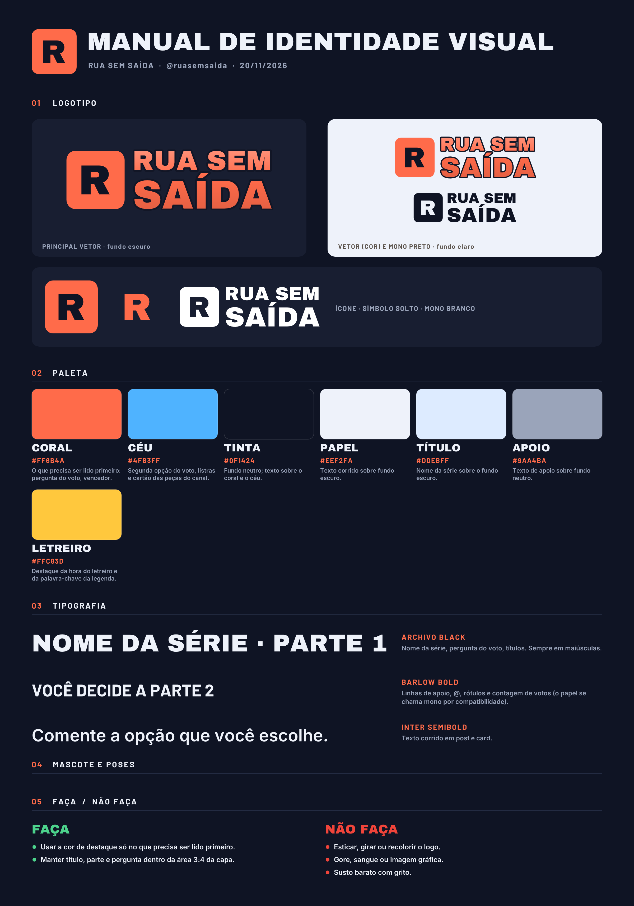

# Manual de identidade visual · Rua Sem Saída

Gerado por `gerar_idv.py` a partir de `marca.json` em 20/11/2026. Para mudar qualquer coisa aqui, edite o marca.json e rode de novo: este arquivo é saída, não fonte.

**Nome:** Rua Sem Saída · **Perfil:** @ruasemsaida  
**Slogan:** Histórias de madrugada em que você decide o próximo passo.  
**Chamada:** Suspense de madrugada que você decide



## Paleta

| Cor | Hex | Onde usar |
|---|---|---|
| Coral | `#FF6B4A` | O que precisa ser lido primeiro: pergunta do voto, vencedor. Texto escuro em cima. |
| Céu | `#4FB3FF` | Segunda opção do voto, listras e cartão das peças do canal. Texto escuro em cima. |
| Tinta | `#0F1424` | Fundo neutro; texto sobre o coral e o céu. |
| Papel | `#EEF2FA` | Texto corrido sobre fundo escuro. |
| Título | `#DDEBFF` | Nome da série sobre o fundo escuro. |
| Apoio | `#9AA4BA` | Texto de apoio sobre fundo neutro. |
| Letreiro | `#FFC83D` | Destaque da hora do letreiro e da palavra-chave da legenda. |

### Cor de cada série

Só nas peças da série (listras do fundo, cartão, rótulo, anel do destaque). A marca continua com o destaque e o acento do canal.

| Série | Hex | Pose do mascote no destaque |
|---|---|---|
| O Último Ônibus | `#4FB3FF` | None |

## Tipografia

| Papel | Fonte | Onde usar | Licença |
|---|---|---|---|
| titulo | Archivo Black | Nome da série, pergunta do voto, títulos. Sempre em maiúsculas. | SIL OFL 1.1 |
| mono | Barlow Bold | Linhas de apoio, @, rótulos e contagem de votos (o papel se chama mono por compatibilidade). | SIL OFL 1.1 |
| texto | Inter SemiBold | Texto corrido em post e card. | SIL OFL 1.1 |

## Logotipo

| Arquivo | Para quê |
|---|---|
| `logo/logo_principal_vetor.png/.svg` | Versão vetorial (símbolo + nome na fonte do logo). Tamanhos grandes, impressão, fundo claro. |
| `logo/icone_quadrado_1024.png/.svg` | Símbolo no quadrado da cor de destaque: favicon, app, marca d'água. |
| `logo/icone_simbolo_transparente.png/.svg` | Símbolo solto, sobre foto ou fundo escuro. |
| `logo/logo_mono_branco` / `logo_mono_preto` | Uma cor só: carimbo, gravação, fundo de foto. |
| `logo/icone_mono_branco` / `icone_mono_preto` | Símbolo em uma cor. |

Área de respiro: no mínimo a altura do símbolo em volta do logo. Tamanho mínimo do logo vetorial: 120 px de largura na tela; abaixo disso, use só o ícone.

## Mascote


| Pose | Arquivo | Quando usar |
|---|---|---|

Nunca estique, gire em eixo, recolora ou recorte a borda branca do adesivo. Escala sempre uniforme.

## Voz da marca

1. Português do Brasil, sério e sussurrado, frases curtas, como um segredo contado no fundo do ônibus.
2. O medo vem da volta para casa de madrugada: ônibus vazio, ponto sob o poste, avenida deserta.
3. Toda parte termina numa escolha com duas opções claras.
4. É ficção, e isso aparece na tela e no post.
5. Quem discorda é ouvido: a escolha da maioria vira a parte seguinte.

## Faça

- Usar a cor de destaque só no que precisa ser lido primeiro.
- Manter título, parte e pergunta dentro da área 3:4 da capa.

## Não faça

- Esticar, girar ou recolorir o logo.
- Gore, sangue ou imagem gráfica.
- Susto barato com grito.

## Medidas das peças e fontes

| Peça | Medida | Fonte |
|---|---|---|
| Foto de perfil | 1080x1080 (exibida em círculo de 98 px no YouTube) | YouTube Help: Manage your channel branding (support.google.com/youtube/answer/10456525) |
| Banner do YouTube | 2560x1440; mínimo 2048x1152; área segura 1235x338 no mínimo = 1546x423 em 2560x1440 | YouTube Help: Manage your channel branding (support.google.com/youtube/answer/10456525) |
| Marca d'água do YouTube | 150x150, quadrada, menos de 1 MB | YouTube Help: Manage your channel branding (support.google.com/youtube/answer/10456525) |
| Capa de playlist / miniatura | 16:9; recomendado 3840x2160; largura mínima 640; 2 MB no celular | YouTube Help: Add custom thumbnails (support.google.com/youtube/answer/72431) |
| Capa de Reels/TikTok/Shorts | 1080x1920 (9:16); a grade do Instagram mostra o miolo 3:4 (1080x1440) | Guias de terceiros (Hopper HQ, Planoly, 2025-2026); o Instagram não publica a medida em página oficial |
| Post de feed | 1080x1350 (4:5); na grade 3:4 perde ~34 px de cada lado | Guias de terceiros (Hopper HQ, Planoly, 2025-2026) |
| Capa de destaque | 1080x1920; o Instagram recorta um círculo no centro | Prática corrente; o Instagram não publica a medida em página oficial |

## Arquivos gerados

- `./logo/logo_principal_vetor.png` · logo/logo_principal_vetor.png
- `./logo/logo_mono_branco.png` · logo/logo_mono_branco.png
- `./logo/logo_mono_preto.png` · logo/logo_mono_preto.png
- `./logo/icone_quadrado_1024.png` · logo/icone_quadrado_1024.png
- `./logo/icone_simbolo_transparente.png` · logo/icone_simbolo_transparente.png
- `./logo/icone_mono_branco.png` · logo/icone_mono_branco.png
- `./logo/icone_mono_preto.png` · logo/icone_mono_preto.png
- `./perfil/perfil_1080.png` · perfil 1080
- `./youtube/banner_2560x1440.jpg` · banner YouTube
- `./youtube/banner_guia_areas.jpg` · banner guia
- `./youtube/marca_dagua_150.png` · marca d'água 150
- `./destaques/destaque_ultimo_onibus.png` · destaque O Último Ônibus
- `./destaques/destaque_como_votar.png` · destaque Como votar
- `./modelos/exemplo/capa_episodio.jpg` · capa episodio
- `./modelos/exemplo/capa_episodio_guia_grade.jpg` · capa episodio guia grade
- `./modelos/exemplo/post_feed.jpg` · post feed
- `./modelos/exemplo/card_parte_disponivel.jpg` · card parte
- `./modelos/exemplo/card_resultado.jpg` · card resultado
- `./modelos/exemplo/capa_playlist_youtube.jpg` · capa playlist
- `./manual_idv.png` · manual_idv.png

## Como gerar uma peça nova

```
python gerar_idv.py modelo capa --marca marca.json --serie ultimo_onibus --parte 2 --subtitulo "NOME DA PARTE" --pergunta "A OU B?" --arte elenco.png --saida capa_p2.jpg
```

Os demais modelos e argumentos estão no README do kit (`kit/idv/README.md`).
