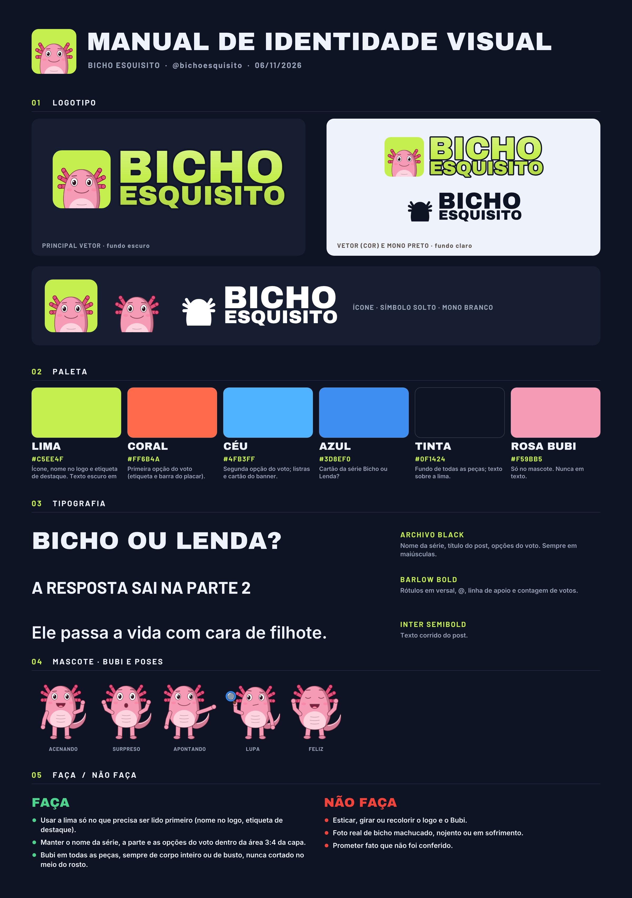

<!-- © 2026 Temporada Viral. Licença de uso pessoal do comprador; redistribuição proibida. Termos: https://temporadaviral.com/termos.html | Autoria: AUTORIA.md | TVK-2026-AF-CC02968C -->
# Manual de identidade visual · Bicho Esquisito

Gerado por `gerar_idv.py` a partir de `marca.json` em 06/11/2026. Para mudar qualquer coisa aqui, edite o marca.json e rode de novo: este arquivo é saída, não fonte.

**Nome:** Bicho Esquisito · **Perfil:** @bichoesquisito  
**Slogan:** Os bichos mais estranhos do planeta, explicados sem enrolação.  
**Chamada:** Curiosidades de bichos que parecem inventados



## Paleta

| Cor | Hex | Onde usar |
|---|---|---|
| Lima | `#C5EE4F` | Ícone, nome no logo e etiqueta de destaque. Texto escuro em cima. |
| Coral | `#FF6B4A` | Primeira opção do voto (etiqueta e barra do placar). |
| Céu | `#4FB3FF` | Segunda opção do voto; listras e cartão do banner. |
| Azul | `#3D8EF0` | Cartão da série Bicho ou Lenda? |
| Tinta | `#0F1424` | Fundo de todas as peças; texto sobre a lima. |
| Rosa Bubi | `#F59BB5` | Só no mascote. Nunca em texto. |

### Cor de cada série

Só nas peças da série (listras do fundo, cartão, rótulo, anel do destaque). A marca continua com o destaque e o acento do canal.

| Série | Hex | Pose do mascote no destaque |
|---|---|---|
| Bicho ou Lenda? | `#3D8EF0` | lupa |
| Top 5 Esquisitos | `#FF6B4A` | surpreso |

## Tipografia

| Papel | Fonte | Onde usar | Licença |
|---|---|---|---|
| titulo | Archivo Black | Nome da série, título do post, opções do voto. Sempre em maiúsculas. | SIL OFL 1.1 |
| mono | Barlow Bold | Rótulos em versal, @, linha de apoio e contagem de votos. | SIL OFL 1.1 |
| texto | Inter SemiBold | Texto corrido do post. | SIL OFL 1.1 |

## Logotipo

| Arquivo | Para quê |
|---|---|
| `logo/logo_principal_vetor.png/.svg` | Versão vetorial (símbolo + nome na fonte do logo). Tamanhos grandes, impressão, fundo claro. |
| `logo/icone_quadrado_1024.png/.svg` | Símbolo no quadrado da cor de destaque: favicon, app, marca d'água. |
| `logo/icone_simbolo_transparente.png/.svg` | Símbolo solto, sobre foto ou fundo escuro. |
| `logo/logo_mono_branco` / `logo_mono_preto` | Uma cor só: carimbo, gravação, fundo de foto. |
| `logo/icone_mono_branco` / `icone_mono_preto` | Símbolo em uma cor. |

Área de respiro: no mínimo a altura do símbolo em volta do logo. Tamanho mínimo do logo vetorial: 120 px de largura na tela; abaixo disso, use só o ícone.

## Mascote

Bubi é um axolote rosa no estilo cápsula do kit: corpo de feijão, três brânquias magenta de cada lado da cabeça, barriga clara, sorriso largo e rabo de nadadeira. Cor chapada, sombra dura e contorno no tom escuro da própria cor. Desenhado só por código (mascote/desenhar_mascote.py).

| Pose | Arquivo | Quando usar |
|---|---|---|
| acenando | `acenando.png` | Boas-vindas, destaque Comece aqui, post de apresentação. |
| surpreso | `surpreso.png` | Capa de episódio com fato que parece mentira. |
| apontando | `apontando.png` | Chamar para a parte nova, para o voto ou para o link. |
| lupa | `lupa.png` | Investigação: série Bicho ou Lenda?, playlist. |
| feliz | `feliz.png` | Resultado do voto, comemoração. |

Nunca estique, gire em eixo, recolora ou recorte a borda branca do adesivo. Escala sempre uniforme.

## Voz da marca

1. Português do Brasil, frases curtas, tom de amigo contando uma coisa absurda que acabou de descobrir.
2. O riso vem do bicho, nunca de zombar de gente: comparação com o dia a dia (do tamanho de uma tampinha, mais lento que fila de banco).
3. Todo fato tem fonte e é conferido antes de gravar; quando a ciência ainda não sabe, o canal diz que não sabe.
4. Toda peça termina numa pergunta aberta: o que você acha que acontece, bicho ou lenda.
5. Quem discorda é bem-vindo: o canal responde com a fonte, sem ironia.

## Faça

- Usar a lima só no que precisa ser lido primeiro (nome no logo, etiqueta de destaque).
- Manter o nome da série, a parte e as opções do voto dentro da área 3:4 da capa.
- Bubi em todas as peças, sempre de corpo inteiro ou de busto, nunca cortado no meio do rosto.

## Não faça

- Esticar, girar ou recolorir o logo e o Bubi.
- Foto real de bicho machucado, nojento ou em sofrimento.
- Prometer fato que não foi conferido.

## Medidas das peças e fontes

| Peça | Medida | Fonte |
|---|---|---|
| Foto de perfil | 1080x1080 (exibida em círculo de 98 px no YouTube) | YouTube Help: Manage your channel branding (support.google.com/youtube/answer/10456525) |
| Banner do YouTube | 2560x1440; mínimo 2048x1152; área segura 1235x338 no mínimo = 1546x423 em 2560x1440 | YouTube Help: Manage your channel branding (support.google.com/youtube/answer/10456525) |
| Marca d'água do YouTube | 150x150, quadrada, menos de 1 MB | YouTube Help: Manage your channel branding (support.google.com/youtube/answer/10456525) |
| Capa de playlist / miniatura | 16:9; recomendado 3840x2160; largura mínima 640; 2 MB no celular | YouTube Help: Add custom thumbnails (support.google.com/youtube/answer/72431) |
| Capa de Reels/TikTok/Shorts | 1080x1920 (9:16); a grade do Instagram mostra o miolo 3:4 (1080x1440) | Guias de terceiros (Hopper HQ, Planoly, 2025-2026); o Instagram não publica a medida em página oficial |
| Post de feed | 1080x1350 (4:5); na grade 3:4 perde ~34 px de cada lado | Guias de terceiros (Hopper HQ, Planoly, 2025-2026) |
| Capa de destaque | 1080x1920; o Instagram recorta um círculo no centro | Prática corrente; o Instagram não publica a medida em página oficial |

## Arquivos gerados

- `./logo/logo_principal_vetor.png` · logo/logo_principal_vetor.png
- `./logo/logo_mono_branco.png` · logo/logo_mono_branco.png
- `./logo/logo_mono_preto.png` · logo/logo_mono_preto.png
- `./logo/icone_quadrado_1024.png` · logo/icone_quadrado_1024.png
- `./logo/icone_simbolo_transparente.png` · logo/icone_simbolo_transparente.png
- `./logo/icone_mono_branco.png` · logo/icone_mono_branco.png
- `./logo/icone_mono_preto.png` · logo/icone_mono_preto.png
- `./perfil/perfil_1080.png` · perfil 1080
- `./youtube/banner_2560x1440.jpg` · banner YouTube
- `./youtube/banner_guia_areas.jpg` · banner guia
- `./youtube/marca_dagua_150.png` · marca d'água 150
- `./destaques/destaque_bicho_ou_lenda.png` · destaque Bicho ou Lenda?
- `./destaques/destaque_top_esquisitos.png` · destaque Top 5 Esquisitos
- `./destaques/destaque_comece_aqui.png` · destaque Comece aqui
- `./destaques/destaque_resultados.png` · destaque Resultados
- `./modelos/exemplo/capa_episodio.jpg` · capa episodio
- `./modelos/exemplo/capa_episodio_guia_grade.jpg` · capa episodio guia grade
- `./modelos/exemplo/post_feed.jpg` · post feed
- `./modelos/exemplo/card_parte_disponivel.jpg` · card parte
- `./modelos/exemplo/card_resultado.jpg` · card resultado
- `./modelos/exemplo/capa_playlist_youtube.jpg` · capa playlist
- `./manual_idv.png` · manual_idv.png

## Como gerar uma peça nova

```
python gerar_idv.py modelo capa --marca marca.json --serie bicho_ou_lenda --parte 2 --subtitulo "NOME DA PARTE" --pergunta "A OU B?" --arte elenco.png --saida capa_p2.jpg
```

Os demais modelos e argumentos estão no README do kit (`kit/idv/README.md`).
